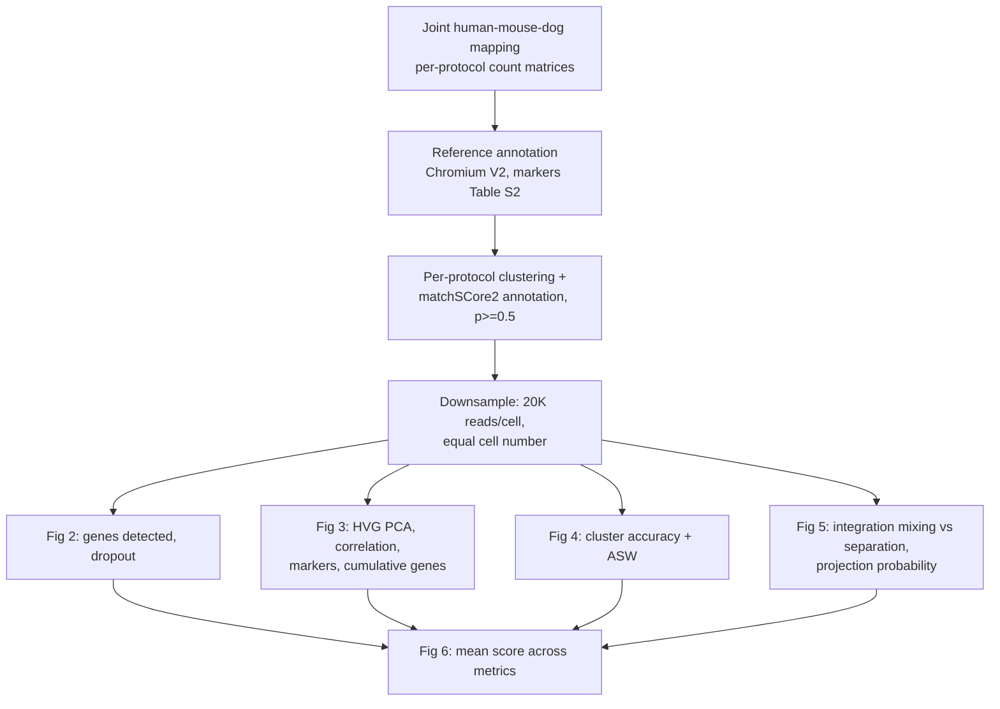

# Methodology

Source: Mereu, Lafzi *et al.*, Nat Biotechnol 38:747–755 (2020), via the open [bioRxiv preprint 630087v1](https://www.biorxiv.org/content/10.1101/630087v1)
and the published abstract/figure legends. **The Online Methods and supplementary parameters were not accessible**; settings below are not claimed to match them.

## Study design (paper)
One reference sample, prepared in a single batch and cryopreserved: human PBMC 60%, mouse colon 30%, HEK293T 6%, NIH3T3 3%, MDCK (dog) 1%.
Profiled with 13 sc/snRNA-seq protocols (~3,000 cells each; 5 plate-based, 7 microfluidic, 1 single-nucleus). A Chromium variant with >50,000 cells
(30,807 human, 19,749 mouse) provides annotation references.

## This replication vs the paper
| Paper step | Paper | This repo | Match |
|---|---|---|---|
| Primary processing | Joint-genome mapping | Starts from GEO count matrices | Not reproduced |
| Cell-type labels | matchSCore2 projection | External labels in `metadata.csv` | Not implemented |
| Downsampling | 20K reads/cell + equal cells | Equal cells only | Partial |
| Fig 2 | Genes/dropout by cell type, vs depth | Overall median genes/UMIs/mito % | Partial |
| Fig 3 | PCA, correlation, markers, cumulative genes | — | Not implemented |
| Fig 4 | Cluster accuracy + ASW | ARI, NMI, silhouette, subsample stability | Approximate |
| Fig 5 | Integration, projection | — | Not implemented |
| Fig 6 | Mean of scores | Table, no composite | Not implemented |

"Cluster accuracy" is not defined in the accessible text; ARI/NMI are stand-ins, and subsample stability is an added metric.

## Our pipeline
QC (min genes, max mito %) → equalise cells → library-size normalise + log1p → top-variance genes → PCA → kNN (k=15) → Louvain → ARI/NMI/silhouette + stability over 80% subsamples ×5.
Interactive version with metric illustrations: `site/methodology.html`.
